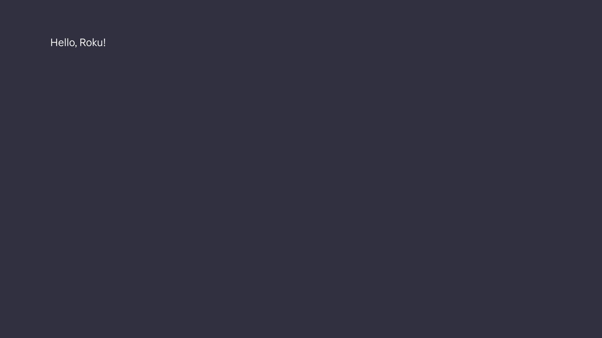

# Starting a New Project

Let's build a small Roku app with BrighterScript, starting from an empty folder. By the end, you'll be able to build it and run it on a Roku device with a single command.

## Create the project

You need [Node.js](https://nodejs.org/) installed. Create a folder for your app, and install BrighterScript in it:

```bash
mkdir hello-roku
cd hello-roku
npm init -y
npm install brighterscript --save-dev
```

## Create a bsconfig.json

The `bsconfig.json` file tells the compiler how to build your project. Create one with:

```bash
npx bsc --init
```

The recommended settings it starts with are described in [Configuration](configuration.md). Two matter for this tutorial: your built app goes in a `dist` folder, and `autoImportComponentScript` is turned on, so each component's XML file automatically includes the script with the same name.

Your app's files will live in a `src` folder, so find the `rootDir` line, uncomment it, and set it to `src`:

```jsonc title="bsconfig.json"
    "rootDir": "src",
```

## Add your app's files

A Roku app needs a `manifest` file, a `source` folder with a `main` function, and usually some SceneGraph components. Create these files:

```
hello-roku/
├── bsconfig.json
├── package.json
└── src/
    ├── manifest
    ├── source/
    │   └── main.bs
    └── components/
        ├── MainScene.xml
        └── MainScene.bs
```

The `manifest` describes your app:

```ini title="src/manifest"
title=Hello BrighterScript
major_version=1
minor_version=0
build_version=0
ui_resolutions=fhd
```

`main.bs` runs when the app starts. It creates the screen and shows the app's first scene:

```brighterscript title="src/source/main.bs"
sub main()
    screen = createObject("roSGScreen")
    port = createObject("roMessagePort")
    screen.setMessagePort(port)
    screen.createScene("MainScene")
    screen.show()

    while true
        msg = wait(0, port)
        if type(msg) = "roSGScreenEvent" and msg.isScreenClosed()
            return
        end if
    end while
end sub
```

`MainScene.xml` declares the scene and the nodes it contains:

```xml title="src/components/MainScene.xml"
<?xml version="1.0" encoding="utf-8" ?>
<component name="MainScene" extends="Scene">
    <children>
        <Label id="greeting" translation="[160, 120]" />
    </children>
</component>
```

`MainScene.bs` is the scene's script. It doesn't need a `<script>` tag in the XML file, because `autoImportComponentScript` adds one when you build:

```brighterscript title="src/components/MainScene.bs"
sub init()
    name = "Roku"
    m.top.findNode("greeting").text = `Hello, ${name}!`
end sub
```

## Build the app

Run the compiler:

```bash
npx bsc
```

The compiler checks your code for errors, then writes the built app to `dist`. Each `.bs` file is transpiled to a `.brs` file. For example, the [template string](../language-features/template-strings.md) in `MainScene.bs` becomes string concatenation:

```brightscript title="dist/components/MainScene.brs"
sub init()
    name = "Roku"
    m.top.findNode("greeting").text = ("Hello, " + bslib_toString(name) + "!")
end sub
```

`bslib_toString` comes from `dist/source/bslib.brs`, a small runtime library that the compiler adds to every project. The `.map` files next to each script are the source maps.

Add `dist` and `node_modules` to your `.gitignore`, since they're generated.

## Run it on a device

To sideload apps, your Roku device needs to be in developer mode. Follow Roku's [developer setup guide](https://developer.roku.com/docs/developer-program/getting-started/developer-setup.md) to turn it on and set a password.

Next, let's install [roku-deploy](https://github.com/rokucommunity/roku-deploy), which sends your built app to the device. Version 4 is currently published under the `next` tag:

```bash
npm install roku-deploy@next --save-dev
```

roku-deploy reads your device's address and password from a `rokudeploy.json` file. Create one next to your `bsconfig.json`, using your device's IP address and the password you set:

```jsonc title="rokudeploy.json"
{
    "host": "192.168.1.10",
    "password": "your_password"
}
```

This file contains your device's password, so add it to your `.gitignore` as well.

Now sideload the `dist` folder. roku-deploy zips it and installs it on your device:

```bash
npx roku-deploy sideload --dir dist
```

The app opens on your Roku:



To build and sideload with a single command, add both steps to the scripts in your `package.json`:

```json title="package.json"
{
    "scripts": {
        "build": "bsc",
        "sideload": "roku-deploy sideload --dir dist",
        "start": "npm run build && npm run sideload"
    }
}
```

Now `npm start` builds your app and runs it on your device.

## Next steps

- Install the [BrightScript Language extension](https://marketplace.visualstudio.com/items?itemName=RokuCommunity.brightscript) for VS Code to see errors as you type, and to debug your app on a device with your source maps.
- Learn the language features you'll use most: [types](../language-features/types.md), [namespaces](../language-features/namespaces.md), [classes](../language-features/classes.md) and [imports](../language-features/imports.md).
- Browse the [bsconfig.json reference](../tooling/bsconfig.md) for every build option.
