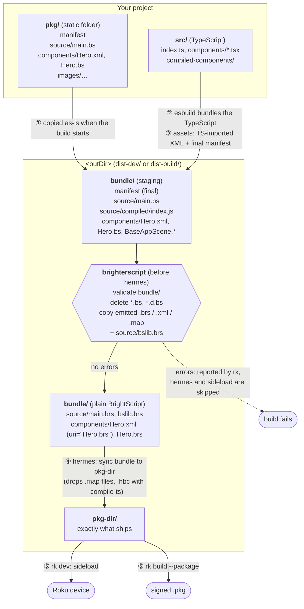

# Roku RSG SDK (`rk`) integration

> **Experimental.** This integration depends on the RSG SDK's build pipeline order, which is documented but still in beta.

The [Roku RSG SDK](https://gitlab.com/rokudev/rsg-sdk) builds TypeScript/SolidJS apps with its `rk` CLI (`rk build`, `rk dev`). Anything that is not TypeScript (the manifest, images, and any SceneGraph XML or BrightScript) lives in the app's static folder, `pkg/` by default, and is copied into the channel as-is.

`withBrighterScript` lets you write that static code in BrighterScript. `rk` compiles it on every build, including `rk dev --watch`, and `rk` still does the packaging and sideloading.

## Setup

Install brighterscript in the app:

```bash
pnpm add -D brighterscript
```

Wrap the config in `roku-config.ts`:

```ts
import type { RokuConfig } from "@roku-sdk/rsg-ts/roku-config";
import { withBrighterScript } from "brighterscript";

export default withBrighterScript({
    app: {
        entryPoint: "src/index.ts"
    }
} satisfies RokuConfig);
```

Then write `.bs` files in `pkg/` and reference them from XML as usual:

```text
pkg/
├── manifest
├── source/
│   └── main.bs
└── components/
    ├── Hero.xml        <script uri="Hero.bs" />
    └── Hero.bs
```

`withBrighterScript` works for BrightScript-only apps (`app.brsOnly: true`) as well, and it keeps any `pipeline` hooks and plugins you already have.

### Editor support

Add a `bsconfig.json` at the app root that points at the static folder, so the BrighterScript VSCode extension validates the same files:

```json
{
    "rootDir": "pkg"
}
```

The build uses this same file, so diagnostic filters, plugins (for example `@rokucommunity/bslint`) and compiler options stay the same in the editor and in `rk`. The `rootDir` and `outDir` values in it are ignored during an `rk` build, because `rk` decides where the files live.

## How it works

`rk` stages the app in `<outDir>/bundle` (`dist-dev/` for `rk dev`, `dist-build/` for `rk build`). It then runs a chain of esbuild steps, and the last of them sync the bundle into `<outDir>/pkg-dir`, which is what gets zipped and sideloaded. `withBrighterScript` adds one step to that chain, just before `hermes`:



Some details:

- **`pkg/` is never modified.** Only the staged copy in `bundle/` is rewritten, and `rk` rebuilds `pkg-dir/` from it on every build.
- **The whole app is validated.** BrighterScript sees the bundle exactly as it will ship, so a `.bs` component can extend a component that `rk` generated from TypeScript (such as `BaseAppScene`).
- **Errors stop the deploy.** BrighterScript diagnostics are added to esbuild's build result, so `rk` prints them like TypeScript errors and skips `hermes` and `sideload`. They point at your file in `pkg/`, not at the staged copy. Warnings are reported but don't stop the build, unless you set `warningsAsErrors`.
- **The manifest is left alone.** `rk` has already written the final manifest, including `transformManifest` changes, and BrighterScript does not overwrite it.
- **The position matters.** The plugin must run after `assets`, which deletes files it doesn't recognize from `bundle/components/`, and before `hermes`, which builds `pkg-dir/`. `postBuild` runs after sideloading, so it is too late. BrightScript-only apps have no named steps, so the plugin is added `first`, ahead of the step that copies the bundle into `pkg-dir/`.
- **Watch mode works.** `rk dev --watch` already rebuilds when anything in `pkg/` changes, so saving a `.bs` file rebuilds and redeploys.

## Options

```ts
export default withBrighterScript(config, {
    // path to a bsconfig.json (default: the nearest bsconfig.json at or above the project root)
    project: "./bsconfig.json",
    // bsconfig options that override the project file
    bsConfig: { sourceMap: true },
    // treat BrighterScript warnings as build errors, which stops sideloading
    warningsAsErrors: false
});
```

`withBrighterScript` takes `outDir`, `rootDir` and `app.staticAssetsDir` from the config `rk` passes to its `preBuild` hook, so command-line flags such as `--out-dir` are honored.

For finer control, `createRokuSdkBrighterScriptPlugin(getConfig, command, options)` returns the esbuild plugin on its own, so you can place it in `pipeline.build.plugins` / `pipeline.startDev.plugins` yourself.

## Known limitations

- **Debugging:** `rk`'s debugger maps device paths straight back to `pkg/`, so breakpoints in `.bs` files don't bind yet. That needs `rk` to read the `.brs.map` source maps.
- **Crash stack traces:** `rk decode-stack` doesn't map BrightScript frames back to `.bs` lines yet.
- **Speed:** each build cycle creates a new BrighterScript program. Reusing one program across watch rebuilds would make large apps faster.
- **Leftover output:** `rk` doesn't clear `bundle/` between watch rebuilds, so the `.brs` file from a deleted `.bs` file can stay until the next full build.
